# dotfiles

<picture>
  <source media="(prefers-color-scheme: dark)" srcset="docs/diagrams/repo-overview-dark.svg">
  
</picture>

Personal macOS setup as code: Ghostty, zsh + powerlevel10k, tmux, WezTerm, yazi, btop, git,
and the fonts and packages they need. Managed with [chezmoi](https://www.chezmoi.io/).

This repository **is** the chezmoi source. `$HOME` holds copies — not symlinks — so edits
belong here, and one command puts them on the machine.

**The goal is one thing: a genuinely bare Mac — stock macOS, an admin user, a network
connection, no Command Line Tools, no Homebrew, no git — becoming this exact setup.** That
is the standard every change here is measured against, and `scripts/verify.sh` is how it is
proved. Setting up such a machine? [Jump to the bootstrap steps](#new-machine).

If you are not me, the configs are readable but they are not a template: change the identity
in `.gitconfig` and expect no support. There is no promise that today's checkout applies
cleanly next month.

## Daily work

Four commands cover almost everything:

| I want to… | Run |
|---|---|
| edit a managed file | `chezmoi edit ~/.zshrc` |
| see what would change | `chezmoi diff` |
| make the machine match the repo | `chezmoi apply` |
| jump into the source repo | `chezmoi cd` |

A normal change is short:

```sh
chezmoi edit ~/.config/ghostty/config   # opens the repo copy, not the live file
chezmoi diff                            # review before writing anything
chezmoi apply                           # copy it into $HOME
git -C ~/Repositories/dotfiles commit -am "ghostty: font size 13"
```

Some changes only land after the app reloads:

| App | Reload |
|---|---|
| Ghostty | `⌘⌃,` (reload config) or open a new window |
| zsh | `exec zsh` |
| tmux | `tmux source-file ~/.tmux.conf` |
| yazi, btop | relaunch |

### The one rule

**Edit the repo, not `$HOME`.** `chezmoi apply` overwrites live files with no prompt. If you
already edited a live file by accident, pull it into the repo instead of applying:

```sh
chezmoi add ~/.zshrc     # one file: live → repo
chezmoi re-add           # all drifted managed files: live → repo
chezmoi status           # one line per managed file that differs
```

Look at `chezmoi diff` before `apply`. That diff *is* the review step.

## Keeping it up to date

Changes travel through git:

```sh
# on the machine where you made the change
git -C ~/Repositories/dotfiles push

# on every other machine
chezmoi update            # git pull + chezmoi apply
```

`chezmoi update` stops if the pull fails, so a conflict never half-applies. Resolve it in the
repo with normal git commands, then run `chezmoi apply`.

If the other machine has local drift you care about, pull it in before updating:

```sh
chezmoi diff              # what would be overwritten
chezmoi re-add            # keep the local edits
git -C ~/Repositories/dotfiles commit -am "capture local changes"
chezmoi update
```

Package updates are separate:

```sh
brew bundle check  --file="$HOME/Repositories/dotfiles/Brewfile"
brew bundle install --file="$HOME/Repositories/dotfiles/Brewfile"
```

`Brewfile` is the required baseline and is installed on every machine. Everything else comes
from the optional inventory in `Brewfile.d/`, selected per machine with
`./bootstrap.sh --select`. The choice is saved in
`~/.local/state/dotfiles/selection`; bootstrap materializes it into
`~/.local/state/dotfiles/Brewfile.selected` and installs that.

## Adding something new

```sh
chezmoi add ~/.config/foo/config    # track a live file (writes dot_config/foo/config here)
chezmoi add --secrets error ~/.foo  # same, but abort instead of warning on secret-like content
chezmoi add --encrypt ~/.secret     # age-encrypted source file
```

Rules for this repo:

- Anything that should land in `$HOME` belongs in the source tree as `dot_*` / `dot_config/…`.
- Anything repo-only (docs, scripts, manifests) must be listed in `.chezmoiignore` —
  `docs/`, `scripts/`, `README.md`, `Brewfile`, and `Brewfile.d/` already are.
- Prefer `--secrets error` when adding files. `verify.sh` also fails if a known secret or
  state path becomes managed.
- Encryption is wired (age) but idle. Back up `~/.config/chezmoi/key.txt` before the first
  secret depends on it; a new machine cannot decrypt without it.

Agent skills are not vendored. `scripts/skills.conf` names the upstreams; `bootstrap.sh`
clones them under `~/.local/share/dotfiles/upstreams/` and links every skill into
`~/.agents/skills`. Re-running `./bootstrap.sh` is the update path; add another upstream by
adding one line to `scripts/skills.conf`. The checkouts, the links, the migration backup and
the old lockfile are excluded from chezmoi in `.chezmoiignore`.

macOS preferences are not managed files either. Add or change a key in
`scripts/macos-defaults.tsv` (group, domain, key, type, value), then select the group with
`./bootstrap.sh --select`. Keep entries reversible and avoid sudo, Gatekeeper and FileVault.

## New machine

A bare Mac has no `git`, no compiler and therefore no Homebrew, so the first two steps stay
manual:

```sh
xcode-select --install                                     # GUI dialog; click through it
git clone https://github.com/footstep27/dotfiles.git ~/Repositories/dotfiles
cd ~/Repositories/dotfiles
./bootstrap.sh --dry-run     # see the plan (checklist is read-only)
./bootstrap.sh               # first run opens the optional checklist
```

HTTPS on purpose: a bare machine has no SSH key yet.

On the first interactive run, a single checklist opens: categories of optional software plus
config and macOS toggles for the required tools. Each row carries a one-sentence description,
and `/` matches against names and descriptions. `space` toggles, `a`/`n` select or clear a
category, `A`/`N` do the same for everything, and `enter` saves. Optional
packages and macOS groups start unchecked; required packages are locked. Later runs reuse the
saved selection, so `--select` is the command to revisit it. When a manifest gains items,
bootstrap warns that the inventory changed and points at `--select`.

`bootstrap.sh` is idempotent and runs, in order: Command Line Tools pre-flight → Homebrew
(installing it if absent) → optional inventory → `Brewfile` → selected optional packages →
chezmoi source wiring (including the age recipient) → archive of managed dotfiles when any
drifted → `chezmoi apply` (forced, because the archive preserved the live copies) → selected
macOS preference groups applied with `defaults` → agent skills cloned from their upstreams and
linked into `~/.agents/skills` → Oh My Zsh and powerlevel10k at their pinned commits → Ghostty
terminfo → tmux plugins at their pinned refs → yazi packages → `scripts/verify.sh`.

The selection file is machine state, never repository content. Deselecting an item only skips
its installation; it never uninstalls anything. To remove a config that is no longer selected,
run `./bootstrap.sh --prune`.

The archive lands in `~/.dotfiles-backup-<timestamp>/dotfiles.tar.gz`; restore it with
`tar -xzf … -C /`. Later runs only archive when local files have drifted from the repo.

## What this repo owns

| Area | Managed |
|---|---|
| Shell | `.zshrc`, `.zprofile`, `.zshenv`, `.p10k.zsh`, legacy `.tcshrc` and `.profile` |
| Ghostty | `~/.config/ghostty/config` |
| tmux | `.tmux.conf` (plugins pinned here, installed by bootstrap and loaded by TPM) |
| WezTerm | `.wezterm.lua` + the one theme file actually used, applied only when the WezTerm cask is selected |
| TUIs | `yazi` config, `btop` config and its Catppuccin Macchiato theme |
| Fonts | Maple Mono NF, installed from the required `Brewfile` — nothing manual |
| Git | global `.gitconfig` |
| OpenCode | `~/.config/opencode/cli.json` (theme, diffs, session UI) and `opencode.jsonc` (global config) |
| macOS preferences | optional `macos:*` groups applied by bootstrap with `defaults`; not files, not chezmoi-managed |
| Agent skills | not chezmoi-managed: bootstrap clones the `scripts/skills.conf` upstreams and links them into `~/.agents/skills`, updating on every run |
| Packages | `Brewfile` (required), `Brewfile.d/` (optional categories, selected per machine) |

Deliberately **not** managed: credentials (GPG keys, `gh`), OpenCode secrets and state
(`~/.local/share/opencode/auth.json`, both `service.json` files, `opencode.db*`, plugin
`node_modules`), nvim config, shell histories, Oh My Zsh (Homebrew-vendored), tmux plugin
trees, the WezTerm theme repository clone, `yazi` flavors/plugins (declared in
`package.toml` and restored with `ya pkg install`), the floating skill checkouts, links
and migration backup that `bootstrap.sh` owns under `~/.local/share/dotfiles/` and `~/.agents/`,
and the macOS before-values used by `--revert-macos`.

Those OpenCode and skill paths are listed in `.chezmoiignore` as guards, and `verify.sh` fails
if any of them ever ends up in the source.

`~/.vim` contains only netrw's history file, so it stays unmanaged. If it ever gets real
config, `chezmoi add` it.

## What a fresh machine gets

`./bootstrap.sh` installs the required Homebrew set, installs the optional packages you
checked, copies the selected configs into `$HOME`, applies the selected macOS preference
groups, then clones the agent-skill upstreams and installs tmux plugins and yazi packages from
their own upstreams. Optional packages are not installed unless selected; the required
baseline is never optional.

### Packages

| Tool | What it does here |
|---|---|
| **chezmoi** | Copies the tracked configs into `$HOME` and shows drift before it writes. |
| **age** | Encryption backend for chezmoi; `bootstrap.sh` generates an identity, though nothing is encrypted today. |
| **tmux** | Multiplexer that owns session persistence, with plugins and a pinned status bar. |
| **btop** | TUI system monitor, themed Catppuccin Macchiato. |
| **eza** | `ls` replacement aliased to `eza --icons`, so file types show as glyphs. |
| **bat** | `cat` replacement with syntax highlighting, aliased as `cat` only when the binary exists. |
| **git-delta** | Side-by-side diff pager wired into `git diff` and `git log` through `~/.gitconfig`. |
| **lazygit** | TUI git client on `lg`, and the reason `core.editor` is deliberately unset. |
| **yazi** | Terminal file manager behind the `y` wrapper that changes directory on exit. |
| **zsh-autosuggestions** | Fish-style history suggestions while typing; sourced by `.zshrc`. |
| **zsh-syntax-highlighting** | Command-line colouring as you type; sourced last so it can see the line. |
| **opencode** | Agent CLI whose config in `~/.config/opencode` is managed here. |
| **Ghostty** | Default terminal; the config fixes the Macchiato theme, Maple Mono NF, splits, quick terminal and command-finish notifications. |
| **Maple Mono NF** | The text face and the icon set in one font: prompt glyphs, `eza --icons` and tmux segments resolve without a fallback. |

### Shell framework

`bootstrap.sh` clones these at fixed commits, because Oh My Zsh publishes no tags and a
floating checkout would make two machines differ for no reason:

| Component | Role |
|---|---|
| **Oh My Zsh** | Loads plugins and themes; its `git` plugin supplies the aliases the shell assumes. |
| **powerlevel10k** | The prompt: two lines, instant prompt, git status, and the glyph segments configured in `.p10k.zsh`. |

### Plugins fetched after the configs land

`bootstrap.sh` installs each tmux plugin declared in `.tmux.conf` and checks out
the ref after `#`, so tags and raw commit pins both work. TPM is only the
runtime loader; its installer is not used.

| Plugin | Role |
|---|---|
| **tpm** | tmux plugin manager; installed like any other pinned plugin and run from `.tmux.conf`. |
| **tmux-sensible** | Baseline tmux settings that are safe to agree with. |
| **tmux-resurrect** | Saves and restores sessions across restarts. |
| **tmux-cpu** | CPU load segment in the status bar, pinned to a commit because upstream has no tags. |
| **tmux-battery** | Battery segment in the status bar. |
| **catppuccin/tmux** | Status bar theme, fixed to Macchiato. |
| **yazi: what-size** | Shows real directory sizes on demand, bound to `M` and `C`. |
| **yazi: my-commands** | Personal command menu bound to `F2`; vendored in this repo because it has no upstream. |
| **yazi flavors** | `catppuccin-macchiato` (active), `catppuccin-mocha`, `dracula` and `ayu-dark`, switchable in `theme.toml`. |

### macOS preference groups

Optional, selected per machine with `./bootstrap.sh --select`. Each group is
applied with `defaults` after `chezmoi apply`; `verify.sh` warns when a selected
group drifts. `./bootstrap.sh --revert-macos` restores the values recorded
before the first change and exits without running the rest of the bootstrap.

| Group | What it sets |
|---|---|
| `macos:keyboard` | Fast key repeat, repeat instead of the accent popup, no autocorrect or smart substitutions, full keyboard access. |
| `macos:finder` | Show all extensions, path and status bars, folders first, current-folder search, expanded save and print panels, no `.DS_Store` on network or USB volumes. |
| `macos:screenshots` | `~/Pictures/Screenshots`, PNG, no shadow, no floating thumbnail. |
| `macos:apps` | TextEdit plain text and UTF-8, Activity Monitor all processes, Disk Utility debug options, Safari Develop menu, Terminal secure keyboard entry. |

The definitions live in `scripts/macos-defaults.tsv`. Deselecting a group later
stops future application but does not undo what is already set.

### Settings written into `$HOME`

| Target | What it sets |
|---|---|
| `.zshrc` | Oh My Zsh with powerlevel10k, `PATH` deduplication, `eza`/`bat`/`lazygit` aliases, word-wise `Ctrl+Arrow` bindings, and the `y` wrapper that makes yazi change directory. |
| `.zprofile` | Homebrew shellenv and nvm for login shells. |
| `.zshenv` | Cargo environment for every zsh process. |
| `.profile`, `.tcshrc` | Docker and Cargo paths for the legacy shells. |
| `.p10k.zsh` | Prompt layout: instant prompt, two-line prompt, icons and segments. |
| `.tmux.conf` | `tmux-256color`, true colour and clipboard for `xterm-ghostty`, mouse on, the six pinned plugins, Macchiato status bar. |
| `.wezterm.lua` + `.wezterm-themes/` | WezTerm fallback: Maple Mono NF at 14pt, no tab bar, Catppuccin Macchiato. |
| `.config/ghostty/config` | Theme, font stack, window padding, Option-as-char, German-safe tab and split keys, quick terminal, notification policy. |
| `.config/btop/` | btop settings plus the Catppuccin Macchiato theme file it references. |
| `.config/yazi/` | File-manager layout, mime-based openers, preview tasks, Vim-style keymap, theme selection. |
| `.config/opencode/` | `cli.json` for theme, diff wrapping and session UI; `opencode.jsonc` as the global config stub. |
| `.gitconfig` | Commit identity, delta pager, `diff3` merge conflicts, coloured moved lines, no signing, no editor. |
| `.agents/skills/` | Symlinks into the upstream checkouts; the set follows `scripts/skills.conf` and updates on every bootstrap. |

### Deliberately not installed

Nothing is installed by hand any more, including fonts. What is left out is either a
developer toolchain a given machine may not need, or the full app inventory.

| Not installed | Why |
|---|---|
| **Rust, nvm, Docker, Herd** | Guarded in the shell configs: absent means a warning from `verify.sh`, never an error. |
| **Anything not checked in the inventory** | Optional software is a per-machine selection. Run `./bootstrap.sh --select`; `--all-optional` selects every non-conflicting item. |

## Verifying

```sh
./scripts/verify.sh            # the applied machine: apps, pty, tmux, fonts
./scripts/verify.sh --static   # repo-side only: manifests, dependencies, pins, links, defaults
./scripts/check-bare-shell.sh  # simulated bare Mac: no Rust, nvm, Docker, Herd
./scripts/check-selection.sh   # inventory parser, conflicts, cascades, prune
./scripts/check-macos-defaults.sh  # manifest, typed diff, apply, before-values, revert
```

`verify.sh` prints one row per check, `pass` / `warn` / `FAIL`, and exits non-zero only on
failure. It asserts behaviour, not file contents: the Ghostty config parses, text and icon
faces resolve, zsh loads cleanly through a pty, tmux starts with every plugin at its pinned
ref, and the required tools are actually on `PATH`. Missing requirements fail; absent
optional toolchains warn. The machine is also judged against its own selection: checked
optional packages and configs must be present, unchecked ones are ignored, and a config left
behind by an old selection warns until `--prune` removes it. Selected macOS groups are read
back; drift warns because preferences are not required infrastructure. Two checks are about the
repo rather than the machine: one fails if a font binary becomes tracked, the other if a
managed config contains something secret-shaped.

`--static` skips everything that needs Ghostty, a pty or a tmux server, which makes it the
mode to run on a machine that has just finished bootstrapping.

`check-bare-shell.sh` builds a throwaway `$HOME` with only the managed zsh files and the
pinned framework, starts an interactive zsh with the optional toolchains absent, and fails if
any error reaches the terminal. It is the proof that the shell degrades instead of breaking;
`--rev <commit>` runs the same test against an older revision.

## What stays manual after bootstrap

1. **Default terminal app.** macOS has no dependable CLI for this. Set Ghostty as the default
   in System Settings (or via Finder's "Open With"). iTerm2 and WezTerm are optional inventory
   items if you want fallbacks.
2. **Choose macOS preference groups.** They are opt-in. Run `./bootstrap.sh --select` and check
   the `macOS` category; `./bootstrap.sh --revert-macos` undoes what bootstrap applied. Some
   app defaults, such as Safari’s, only take effect after relaunch.

Those are the only manual steps. The fonts are installed from the `Brewfile`, so there is
nothing to download by hand.

## Troubleshooting

| Symptom | Fix |
|---|---|
| A change disappeared after `apply` | `apply` overwrote the live file. Edit the repo; if the live edit was the good one, `chezmoi re-add` first. |
| Prompt or glyphs look wrong | Run `./scripts/verify.sh`; if the text face is not Maple Mono NF, re-run `./bootstrap.sh`. See `docs/fonts.md`. |
| `xterm-ghostty` unknown over ssh | Rerun `./bootstrap.sh` (copies the bundled terminfo) and check with `infocmp -x xterm-ghostty`. |
| `sourceDir` points at another checkout | Fix `~/.config/chezmoi/chezmoi.toml` so it names this repo, or rerun `bootstrap.sh`. |
| tmux plugins missing | Rerun `./bootstrap.sh`; it installs every pinned plugin directly. TPM's own installer cannot resolve a raw commit pin. |
| Skills missing or stale | Rerun `./bootstrap.sh`. A checkout with local edits is skipped on purpose; inspect it with `git -C ~/.local/share/dotfiles/upstreams/<owner>/<repo> status`. |
| `~/.profile` changes after apply | Docker Desktop rewrites its PATH block with an absolute home path. Bootstrap archives drift and forces the repo version; rerun `./bootstrap.sh` after Docker touches it. |
| macOS defaults drifted | Rerun `./bootstrap.sh` to reapply the selected groups, or `./bootstrap.sh --revert-macos` to undo them. |
| Want to see the plan first | `chezmoi apply --dry-run --verbose` |

## Layout

```
bootstrap.sh            fresh-machine entry point (--select, --dry-run, --prune, --revert-macos)
scripts/select.sh       pure-Bash optional inventory checklist
scripts/lib-selection.sh  manifest parser, selection model, generators
scripts/macos-defaults.tsv  optional macOS preference groups (group, domain, key, type, value)
scripts/lib-macos.sh    defaults diff, apply, before-values, revert and verification
scripts/verify.sh       behaviour checks for the applied machine
scripts/check-bare-shell.sh  simulated bare Mac: the shell must start clean
scripts/check-selection.sh  inventory parser, conflicts, cascades, prune
scripts/check-macos-defaults.sh  defaults manifest, apply, idempotence, revert
GLOSSARY.md             terms: bare Mac, applied machine, selection, required baseline
Brewfile                required packages
Brewfile.d/             optional categories, one editable manifest per group
scripts/skills.conf      agent-skill upstreams, checked out by bootstrap
dot_* / dot_config/     chezmoi-managed configs (names map to $HOME)
dot_tmux.conf           tmux, including pinned plugin refs
docs/                   fonts, themes, decisions, diagram sources
```

`~/.local/state/dotfiles/` is not part of the repo: it holds the saved `selection`, the
inventory snapshot used to spot new items, the generated `Brewfile.selected`, the generated
`ignored-paths` list that `.chezmoiignore` reads, and the macOS before-values used by
`--revert-macos`. `~/.local/share/dotfiles/upstreams/` is machine state too: it holds the
floating skill checkouts that `~/.agents/skills` links into.

The README diagram is generated, not hand-drawn: edit `docs/diagrams/repo-overview.html`
(and `-dark.html`), then re-export with the diagram-design skill:

```sh
python3 ~/.agents/skills/diagram-design/scripts/export_svg.py \
  docs/diagrams/repo-overview.html docs/diagrams/repo-overview.svg --system-fonts
```

## Why it's built this way

- **The repo is the chezmoi source,** and age is the chosen encryption backend. Reasoning in
  [`docs/adr/0001-chezmoi-and-age.md`](docs/adr/0001-chezmoi-and-age.md). age is wired but
  idle: `bootstrap.sh` generates an identity and records the recipient; no file is encrypted.
- **A bare Mac is the success criterion.** Required versus optional is a deliberate split, not
  an accident of what happens to be installed: see
  [`docs/adr/0003-bare-mac-as-the-goal.md`](docs/adr/0003-bare-mac-as-the-goal.md).
- **Optional software is a per-machine selection, not a profile.** One checklist, one saved
  selection per machine, and configs that follow their package or toggle independently: see
  [`docs/adr/0005-interactive-optional-inventory.md`](docs/adr/0005-interactive-optional-inventory.md).
- **Option stays a character key** on the German layout (`macos-option-as-alt = false`).
  Option types `@ { } [ ] | \ ~ €`; word movement lives on `Ctrl+Left/Right` and
  `Ctrl+Backspace`, bound in `.zshrc`.
- **The theme is fixed Macchiato, not system-following.** tmux cannot observe the macOS
  appearance switch, so the status bar stays Macchiato; `window-theme = dark` keeps the frame
  matching. See [`docs/themes.md`](docs/themes.md) for switching.
- **tmux is for persistence, not splitting.** Long-running work in named sessions; quick
  side-by-side work in Ghostty's native splits. Scrollback is capped at 10,000 lines and
  window restore is off because tmux owns persistence.
- **One font, not two.** Maple Mono NF carries the text face and the Nerd Font icons, so
  there is no symbols fallback to keep in sync — and it is redistributable, so the repo can
  install it instead of documenting it. See
  [`docs/adr/0004-free-nerd-font-replaces-monolisa.md`](docs/adr/0004-free-nerd-font-replaces-monolisa.md).
- **`tmux-cpu` is pinned to a commit, not a tag** — the only plugin whose upstream publishes
  no tags (`#bcb110d`).
- **Agent skills float, everything else is pinned.** Skills change often and are meant to be
  editable, so bootstrap fast-forwards them on every run and symlinks them into
  `~/.agents/skills` instead of committing copies: see
  [`docs/adr/0006-agent-skills-from-floating-checkouts.md`](docs/adr/0006-agent-skills-from-floating-checkouts.md).
- **macOS preferences are inventory groups, not managed files.** They are applied with
  `defaults` only when selected, verified with warnings, and reversible per key: see
  [`docs/adr/0007-macos-defaults-as-inventory-groups.md`](docs/adr/0007-macos-defaults-as-inventory-groups.md).
- **`core.editor` is deliberately unset.** Interactive committing goes through `lazygit`.

## Licence

MIT — see [`LICENSE`](LICENSE). Third-party material keeps its own terms: Catppuccin themes
are MIT with attribution collected in
[`THIRD-PARTY-NOTICES.md`](THIRD-PARTY-NOTICES.md). Agent skills are installed from their
upstreams at setup time, not redistributed here. Maple Mono NF is OFL 1.1 and is installed
from Homebrew rather than redistributed here; see [`docs/fonts.md`](docs/fonts.md).
